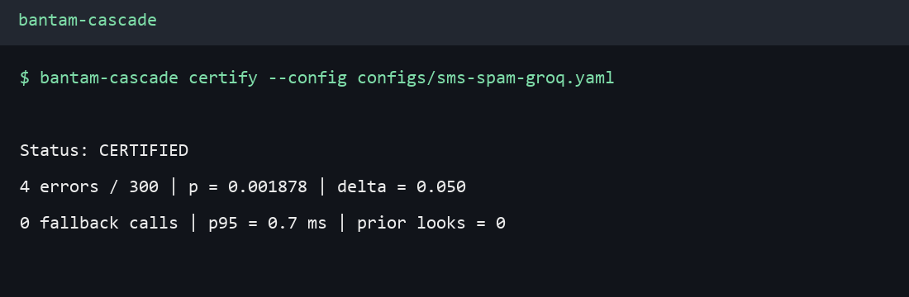

# Bantam Cascade

[](https://github.com/atharvvv10/bantam-cascade/actions/workflows/ci.yml)
[](https://pypi.org/project/bantam-cascade/)

*Bantam Cascade finds a cheap small-CPU-model + big-LLM fallback cascade that meets a user's accuracy requirement under a finite-sample statistical test, or says honestly that it cannot certify one.*

## Status

`v0.1.1` is published on [PyPI](https://pypi.org/project/bantam-cascade/0.1.1/) and [GitHub](https://github.com/atharvvv10/bantam-cascade/releases/tag/v0.1.1). `v0.1.0` remains published with its artifacts unchanged. This revision adds cascade-benefit, statistical-validity, baseline, status, sizing, recall, and licensing evidence. The original SMS certificate has **not** been re-tested or regenerated.

Every number below traces to a run artifact or an offline CLI command. The tool has **one genuine 95% certificate** (SMS Spam, conditional on its documented assumptions) and honest non-certificates elsewhere.

## What the tool does

1. Takes a labeled text-classification dataset plus a target accuracy, confidence level, and p95 latency budget.
2. Trains small CPU-only students on **gold human labels**, calibrates them, and builds a cascade (student answers when confident, teacher otherwise).
3. Uses finite-sample statistics against **gold human labels** to test which configurations meet the target.
4. Returns the cheapest certified configuration or an honest `INSUFFICIENT_EVIDENCE` / `NO_FEASIBLE_CONFIG` status.

All cost figures are **ESTIMATES** derived only from prices in the user's config. The word "certified" always appears with its assumptions attached.

## Quickstart

From a source checkout with the git-ignored frozen run artifacts available:

```text
pip install -e ".[dev]"
bantam-cascade --help

# Inspect the frozen certificate; do not re-run certify on this run-dir
bantam-cascade verify-certificate
bantam-cascade demo "claim your free prize now" --run-dir runs/sms-groq

# Regenerate offline evidence (no keys or API calls needed)
bantam-cascade plan --target-accuracy 0.95 --confidence-level 0.95 --assumed-accuracy 0.98
bantam-cascade validity --trials 200 --examples 600
bantam-cascade status-demo
bantam-cascade reproduce --trials 200 --examples 600
```

To make a **new** certificate, copy a config and use a fresh `--run-dir`; run `certify` only once after pre-registration. `certify` exits non-zero when it cannot issue a certificate; that is an honest result, not a crash. Do **not** re-run it on `runs/sms-groq`: its single pre-registered look is recorded. Use `verify-certificate` to check the frozen artifact without a new look.



The permanent [Bantam Cascade demo Space](https://huggingface.co/spaces/atharv2204/bantam-cascade)
shows student-only decisions at frozen thresholds; no teacher key, fallback
call, or certificate is produced there. The [`space/`](space/) scaffold contains
the same offline app. The Space runs on Hugging Face's free ZeroGPU tier with an
unused `@spaces.GPU` startup marker; inference remains CPU-only.

## Headline result: certified SMS Spam

A single pre-registered `word_tfidf` cascade was tested once on 300 untouched examples from `ucirvine/sms_spam`:

| Item | Value |
| --- | --- |
| Target / confidence | 95% / 95% |
| Measured accuracy | 0.987 (4 errors / 300) |
| Hoeffding-Bentkus p-value | 0.001878 (`delta = 0.05`, 0 prior looks) |
| Fallback calls | 0 |
| Estimated cost | $0.000000 from configured prices |
| p95 latency | 0.7 ms |
| Status | **`CERTIFIED`** |

The threshold was frozen in `runs/sms-groq/preregistration.json` before the certification split was read. The result is conditional on the assumptions in [docs/METHODOLOGY.md](docs/METHODOLOGY.md); see [docs/RESULTS.md](docs/RESULTS.md) for the full record and the separate Banking77 non-certificate.

## Does the cascade actually help?

All rows use the same 300-example certification split and accuracy against **gold human labels**. The student trains on the shown number of gold labels; the teacher is cached and pinned by config.

| Dataset / teacher | Gold labels | Student alone | Teacher alone | Cascade | Fallback rate |
| --- | ---: | ---: | ---: | ---: | ---: |
| SMS Spam / Groq `openai/gpt-oss-20b` | 100 | 0.947 | 0.890 | **0.970** | 0.117 |
| SMS Spam / Groq `openai/gpt-oss-20b` | 300 | 0.947 | 0.890 | 0.967 | 0.193 |
| Banking77 / Gemini `gemini-decision-1` | 2,000 (`minilm_onnx_int8`) | **0.897** | 0.803 | **0.897** | 0.000 |

So yes, on SMS: the small model learns from human labels, and the weaker big model's errors are complementary enough to lift accuracy by 2.3 points at a 100-label budget. On Banking77 the cascade does **not** help with a stronger student; we report that too. Full tables, including `tfidf_baseline` ablations and baselines, are in [docs/RESULTS.md](docs/RESULTS.md).

## Teacher labeling (Phase 1)

Copy `.env.example` to `.env` in the project root and put your provider key in it. Use `GROQ_API_KEY` for Groq or `GEMINI_API_KEY` for Gemini Decisions. The file is git-ignored; never commit or print keys. The **config**, not the key, pins the provider and model.

```text
bantam-cascade label --config configs/banking77.yaml --dry-run
bantam-cascade label --config configs/banking77.yaml --limit 200
bantam-cascade select-teacher --config configs/banking77.yaml --limit 200

bantam-cascade label --config configs/banking77-gemini.yaml --dry-run
bantam-cascade label --config configs/banking77-gemini.yaml --limit 200
```

The shipped Groq config pins `openai/gpt-oss-20b`; the Gemini config pins `gemini-decision-1`, which answers a fixed 2–255-way `choice` question with calibrated probabilities and **zero output tokens**. Both use user-supplied prices (currently `0`) and user-supplied rate limits. Dry run makes no API calls and needs no key.

Measured on the same 200 gold calibration labels (local run artifacts are git-ignored):

| Teacher | Accuracy | Invalid | Input tokens | Output tokens | Mean latency |
|---|---:|---:|---:|---:|---:|
| Groq `openai/gpt-oss-20b` | 0.745 | 0 | 125,883 | 8,288 | 490.4 ms |
| Gemini `gemini-decision-1` | 0.765 | 0 | 158,963 | 0 | 851.2 ms |

Sources: `runs/phase1/teacher_labels.jsonl` and `runs/phase1-gemini/teacher_labels.jsonl`. The four-example gap is a measurement, not a statistical certificate.

## Students and cascade (Phases 2 and 4)

```text
bantam-cascade train-students --config configs/banking77.yaml --run-dir runs/phase2
bantam-cascade build-cascade --config configs/banking77.yaml --run-dir runs/phase2 --dry-run
bantam-cascade build-cascade --config configs/banking77.yaml --run-dir runs/phase2 --calibration-labels runs/phase1/teacher_labels.jsonl
```

Students are `tfidf_baseline` (word TF-IDF + logistic regression, no downloads; formerly `static_embed`, still accepted as a legacy config alias), `word_tfidf` (word 1–2 gram TF-IDF + logistic regression, the certified student), and `minilm_onnx_int8`/`fp32` (MiniLM ONNX for CPU). MiniLM needs the optional ONNX dependencies: `pip install -e ".[students]"`. Students train on **gold human labels**; the teacher is used only as the cascade fallback and is also scored against gold. `build-cascade` reads the 200 calibration labels and labels the certification split with the teacher (resumable via the cache). All outputs go to the selected `--run-dir`. Measurements are not certificates unless the pre-registered Learn-then-Test procedure accepts them.

With the Gemini fallback and its matching calibration labels on 300 certification examples (`runs/phase2-gemini/cascade_results.jsonl`): `tfidf_baseline` measured 0.837 accuracy with 11 fallback calls and 1.5 ms p95; `minilm_onnx_int8` measured 0.920 accuracy with 1 fallback call and 7.3 ms p95. Both are measurements, not certificates.

## Certification (Phase 3)

```text
bantam-cascade certify --config configs/banking77-gemini.yaml \
  --run-dir runs/phase2-gemini \
  --calibration-labels runs/phase1-gemini/teacher_labels.jsonl
```

`certify` verifies that saved teacher rows carry the dataset's gold labels, recomputes calibration statistics using only the thresholds already learned from the 200-example calibration split, then runs Learn-then-Test fixed-sequence testing on the 300-example certification split. The candidate order comes from calibration data only; no certification data is used to change it. Results are written to `<run-dir>/certification_result.json`, and looks at the split are tracked in `<run-dir>/certification_ledger.sqlite3` (reuse requires `--allow-reuse` and divides δ by the total number of looks).

Real run against the configured 95% accuracy target (`runs/phase2-gemini/certification_result.json`):

| Student | Errors / 300 | Measured accuracy | HB p-value | Status |
|---|---:|---:|---:|---|
| `minilm_onnx_int8` | 24 | 0.920 | 1.000 | not rejected |
| `tfidf_baseline` (formerly `static_embed`) | 49 | 0.837 | 1.000 | not rejected |

Outcome: `INSUFFICIENT_EVIDENCE`. At δ = 0.05, neither cascade can reject the hypothesis that its true error rate exceeds 5%. The tool does **not** claim a certificate here.

## Validity, sizing, statuses, and recall

The revision adds evidence for the statistical and operational claims:

| Check | Command | Result |
| --- | --- | --- |
| Procedure validity, 200 resamples | `bantam-cascade validity` | Boundary false-cert rate 0.000 vs naive 0.040 (allowed 0.050). |
| Test-size planning | `bantam-cascade plan --assumed-accuracy 0.98` | 240 certification examples at 95% target/confidence. The original run used 300. |
| All three statuses | `bantam-cascade status-demo` | `CERTIFIED`, `INSUFFICIENT_EVIDENCE`, `NO_FEASIBLE_CONFIG` (synthetic logic demo, not a certificate). |
| Co-primary accuracy + spam recall | `bantam-cascade certify-recall` | Fresh seed-43 split: accuracy 596/600 passes, spam recall 72/74 fails at `delta/2 = 0.025`; status `INSUFFICIENT_EVIDENCE`. |
| Exact binomial cross-check | `verify-certificate` / artifact | SMS p = 0.000691 vs Hoeffding-Bentkus p = 0.001878; both reject at 0.05. |

`bantam-cascade reproduce` regenerates all offline evidence and re-verifies the frozen certificate in one command. It never re-labels the original split.

## How certification works

Learn-then-Test turns risk control into hypothesis testing. With `α = 1 - minimum_accuracy`, each candidate tests `H: risk > α`. Its p-value uses the Hoeffding-Bentkus bound, and a single-start fixed-sequence procedure controls family-wise error at `δ = 1 - confidence_level` (with a further multiple-looks correction on reuse). See [docs/METHODOLOGY.md](docs/METHODOLOGY.md) for the exact formula and assumptions.

## Limitations

See [docs/LIMITATIONS.md](docs/LIMITATIONS.md). Nothing here is a guarantee about deployment data that differs from the certified data. See [docs/COMPLIANCE.md](docs/COMPLIANCE.md) for third-party inference provenance: no teacher labels, caches, or derived models are published, and Gemini-derived exploratory data is not cleared for release. The one-page [blog post](docs/BLOG_POST.md) explains where the approach works and where it does not.

## Releasing

Releases use PyPI Trusted Publishing, so no long-lived PyPI token is stored. See [docs/RELEASING.md](docs/RELEASING.md).

## Prior work and credits

Bantam Cascade does **not** claim novelty for distillation, cascades, or threshold selection with guarantees. It builds on TinyDistill, bounded-distill, FrugalGPT, and Learn-then-Test (Angelopoulos, Bates, Candès, Jordan, Lei). Full citations are in [CITATION.cff](CITATION.cff) and [docs/METHODOLOGY.md](docs/METHODOLOGY.md).

## Naming

The name [`bantam`](https://pypi.org/project/bantam/) on PyPI belongs to an unrelated microservices package. That's why this project uses `bantam-cascade` for its distribution, CLI, and repository, and `bantam_cascade` for its Python import.

## License

Apache-2.0. See [LICENSE](LICENSE).
